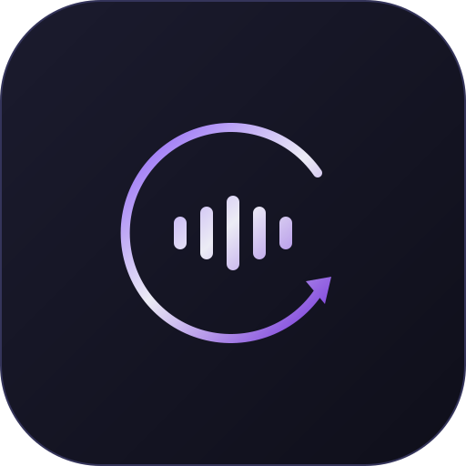
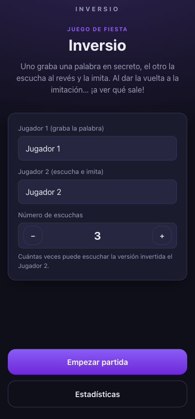
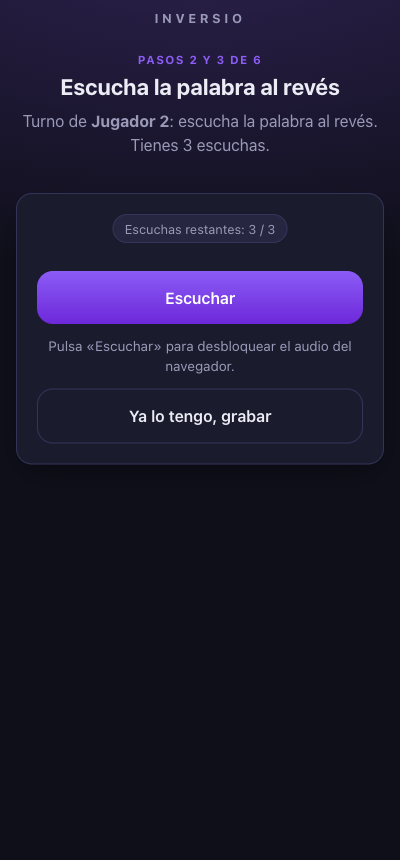
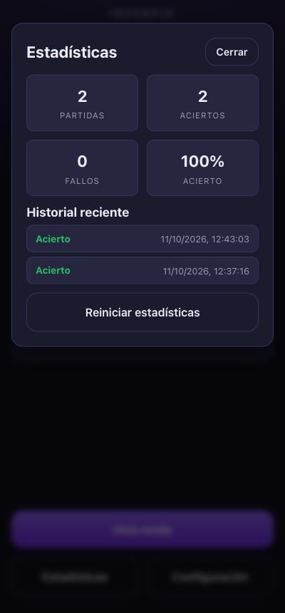

<div align="center">
  
  <h1>Inversio 🔁</h1>
  <p><em>El juego de fiesta en equipo basado en audio y voz invertida.</em></p>

  <p>
    <a href="https://vuejs.org/"></a>
    <a href="https://www.typescriptlang.org/"></a>
    <a href="https://vite.dev/"></a>
    <a href="https://pinia.vuejs.org/"></a>
    <a href="https://vite-pwa-org.netlify.app/"></a>
    <a href="https://github.com/Cuti27/Inversio/actions/workflows/ci.yml"></a>
    
  </p>
</div>

---

**Inversio** es una **PWA** para jugar en grupo con la voz. Uno graba una palabra en secreto,
el otro la escucha **al revés**, intenta imitarla y, al volver a invertir su imitación,
¡sale una versión distorsionada y divertidísima de la palabra original!

Todo el procesamiento de audio ocurre **en el navegador** (Web Audio API + MediaRecorder):
sin backend, sin cuentas y sin subir nada a un servidor.

<br>

<p align="center">
  
  &nbsp;&nbsp;
  
  &nbsp;&nbsp;
  
</p>

---

## 🎮 Cómo se juega

1. **Grabación** — el *Jugador 1* graba una palabra o frase corta en secreto.
2. **Inversión** — la app invierte automáticamente ese audio.
3. **Escucha limitada** — el *Jugador 2* escucha la versión al revés un máximo de **N veces** (configurable). Al agotarlas, la app **fuerza** el paso a grabación.
4. **Imitación** — el *Jugador 2* imita lo que oye y lo graba.
5. **Revelado** — la app invierte su imitación y la reproduce. 🤯
6. **Adivinanza** — el *Jugador 2* intenta acertar la palabra original. ¿Acierto o fallo?

## ✨ Características

- 🎙️ **Grabar y reproducir la reversa** directamente en el navegador.
- 🔢 **Número de escuchas configurable** (1–10) antes de obligar a grabar la imitación.
- 🔊 **Reproducción del resultado final** (imitación invertida) y comparación con el original.
- 💾 **Exportar/compartir el clip final** en WAV (compartir nativo en móvil, descarga en escritorio).
- 📊 **Estadísticas opcionales** de aciertos/fallos con historial, guardadas en el dispositivo.
- 🔁 **Rondas ilimitadas** sin perder el marcador.
- 📲 **PWA instalable** con botón de instalación inteligente (prompt nativo o guía en iOS).
- 🌙 Diseño **mobile-first** oscuro, sin dependencias de UI externas.

## 🧱 Stack técnico

| Capa | Tecnología |
|---|---|
| Framework | Vue 3 (Composition API) |
| Lenguaje | TypeScript |
| Build | Vite |
| Estado | Pinia |
| Audio | Web Audio API + MediaRecorder |
| PWA | `vite-plugin-pwa` (Workbox) |
| Persistencia | `localStorage` |

## 🚀 Empezar

**Requisitos:** Node.js 20+ y **pnpm**. Un navegador con Web Audio API y MediaRecorder.

```bash
# 1. Clonar
git clone https://github.com/Cuti27/Inversio.git
cd Inversio

# 2. Instalar dependencias
pnpm install

# 3. Desarrollo
pnpm dev
```

### Comandos disponibles

| Comando | Descripción |
|---|---|
| `pnpm dev` | Servidor de desarrollo |
| `pnpm build` | Build de producción (type-check + PWA) |
| `pnpm preview` | Previsualiza el build (ideal para probar la PWA) |
| `pnpm icons` | Regenera los iconos PWA desde `public/favicon.svg` |
| `pnpm test` | Ejecuta toda la suite (unit + e2e) |
| `pnpm test:unit` | Tests unitarios con Vitest |
| `pnpm test:e2e` | Tests end-to-end con Playwright |

## ✅ Tests

- **Unitarios (Vitest)** — stores de Pinia (`config`, `stats`, `game`) con el motor de audio simulado.
- **End-to-end (Playwright)** — recorren una partida completa con **micrófono simulado** (flags `--use-fake-device-for-media-stream`), incluida la escucha limitada.

```bash
pnpm test              # unit + e2e
pnpm test:unit         # solo unitarios
pnpm test:e2e          # solo e2e
pnpm exec playwright install chromium   # 1ª vez: instala el navegador
```

## 🚀 Despliegue

El proyecto se despliega automáticamente en **GitHub Pages** con el workflow
[`.github/workflows/ci.yml`](.github/workflows/ci.yml) al hacer push a `main`:

1. **Test** — instala dependencias y ejecuta unit + e2e.
2. **Build** — compila la PWA con `BASE_PATH=/Inversio/`.
3. **Deploy** — publica `dist/` en GitHub Pages.

**URL:** https://cuti27.github.io/Inversio/

> Para activarlo la primera vez: **Settings → Pages → Source: GitHub Actions**.

## 📱 PWA e instalación

La app detecta automáticamente si está corriendo **instalada** o en la **web**:

- **Chrome / Edge / Android** → muestra un botón que lanza el prompt de instalación nativo.
- **iOS (Safari)** → muestra instrucciones manuales (*Compartir → Añadir a pantalla de inicio*).
- Si ya está instalada, el botón **desaparece**.

> Para probar la instalación usa `pnpm build && pnpm preview` (la instalación requiere
> el service worker, que no se activa en modo desarrollo).

## 🧪 Probar en el móvil

El micrófono (`getUserMedia`) y los Service Workers exigen **contexto seguro (HTTPS)**. Opciones:

- **Ya desplegado:** abre https://cuti27.github.io/Inversio/ en el móvil.
- **Túnel local:** `cloudflared tunnel --url http://localhost:5173` (o ngrok) y abre la URL HTTPS en el móvil.

## 📂 Estructura

```
src/
├── composables/
│   ├── useAudioEngine.ts     # AudioContext singleton: decode, reverse, play
│   ├── useAudioRecorder.ts   # getUserMedia + MediaRecorder
│   ├── useAudioLevel.ts      # medidor de nivel del micrófono
│   └── useInstallPrompt.ts   # detección web vs. PWA + guía de instalación
├── stores/
│   ├── config.ts             # nº de escuchas y nombres (localStorage)
│   ├── game.ts               # máquina de estados del juego
│   └── stats.ts              # estadísticas aciertos/fallos (localStorage)
├── components/
    ├── AudioLevel.vue
    ├── InstallPwaButton.vue
    └── screens/              # una pantalla por fase del juego
└── utils/
    └── audioExport.ts        # encoder WAV + compartir/descargar el clip final
scripts/
└── gen-icons.mjs             # genera los PNG de la PWA desde favicon.svg
tests/
├── unit/                     # Vitest (stores)
└── e2e/                      # Playwright (flujo completo)
.github/
└── workflows/ci.yml          # test → build → deploy a GitHub Pages
```

## 🔍 Notas técnicas

- El `AudioContext` es **singleton** y se desbloquea con el primer gesto del usuario (política de autoplay).
- Los `AudioBuffer`/`Blob` se guardan en `shallowRef` (los proxies reactivos de Vue romperían sus métodos nativos).
- La inversión se hace copiando las muestras de cada canal y aplicando `Float32Array.reverse()`.
- El flujo del juego es una **máquina de estados** (`setup → recordOriginal → listenReversed → recordImitation → reveal → guess → result`).

## 🗺️ Roadmap

- [x] Flujo de juego completo (local, pass-and-play)
- [x] PWA instalable + botón de instalación
- [x] Estadísticas en `localStorage`
- [x] Tests (Vitest + Playwright) y CI/CD en GitHub Pages
- [x] Exportar/compartir el clip final (WAV)
- [ ] Multijugador **online** en tiempo real (varios dispositivos)

## 📄 Licencia

Distribuido bajo la licencia **MIT**.

---

<div align="center">
  Hecho con 🎧 y Vue 3.
</div>
